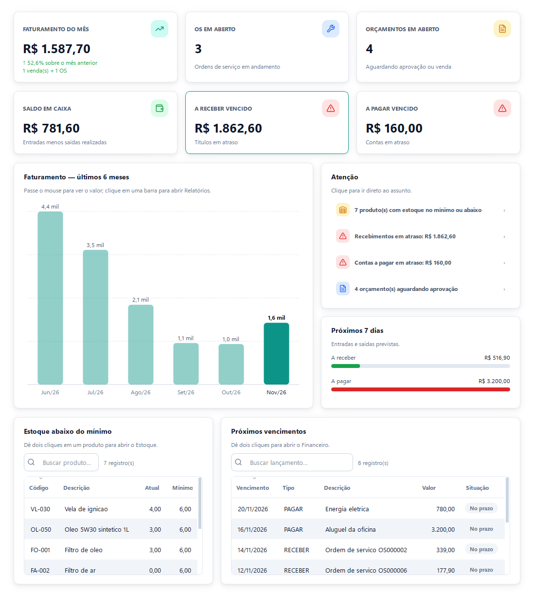
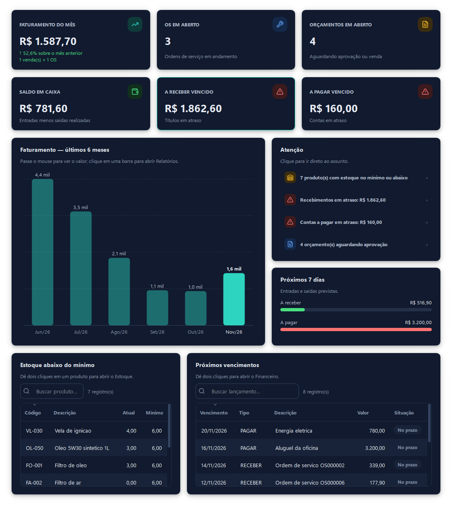
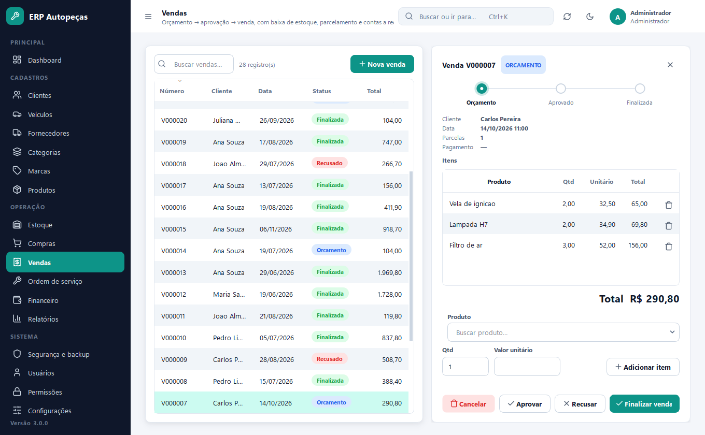
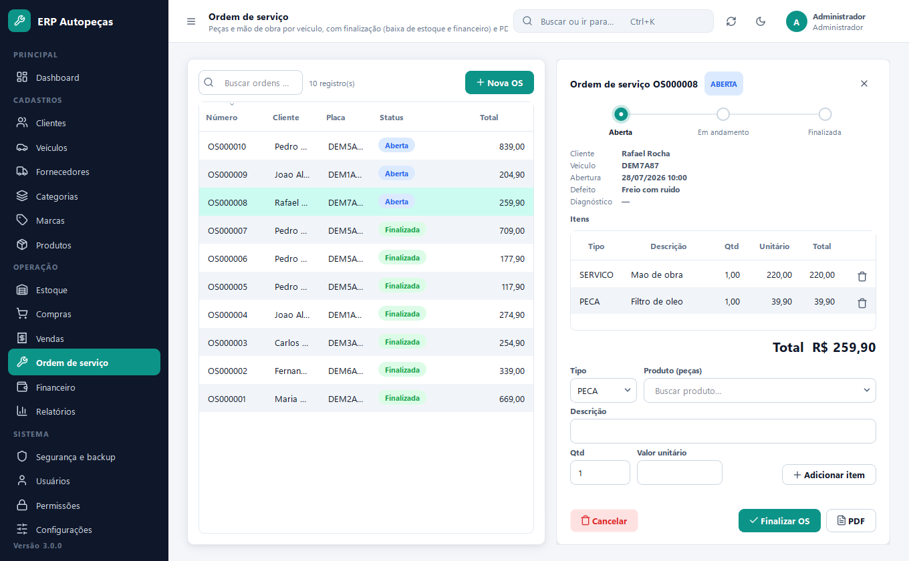
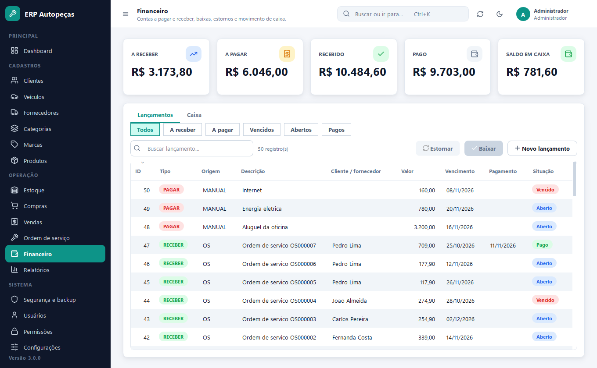
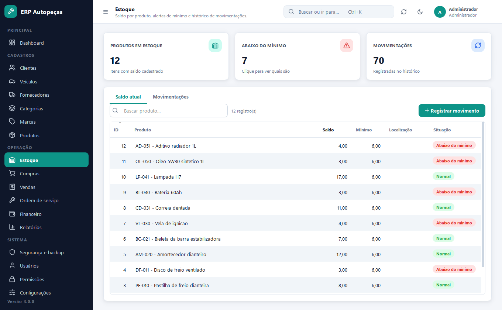

# ERP CRM Autopeças & Serviços

[](https://github.com/flavioZaccheroni/Projeto-CRM---Autopecas-e-Servicos/actions/workflows/ci.yml)

Sistema desktop (Windows) de gestão para autopeças e oficinas: cadastros, estoque, compras, vendas com orçamento,
ordens de serviço, financeiro, relatórios, controle de acesso por perfil e backup. Python + PySide6 (Qt) + SQLAlchemy + SQLite.



## O que o sistema faz

| Área | Destaques |
| --- | --- |
| **Dashboard** | Faturamento do mês, OS e orçamentos em aberto, saldo de caixa, vencidos, gráfico dos últimos 6 meses, estoque abaixo do mínimo e próximos vencimentos (cada bloco respeita as permissões). |
| **Cadastros** | Clientes, veículos, fornecedores, categorias, marcas e produtos, com validação de CPF/CNPJ, placa, UF e telefone. |
| **Estoque** | Saldo, entradas, saídas e ajustes com histórico; movimentação automática por compras, vendas e OS. |
| **Compras** | Recebimento com entrada no estoque e conta a pagar (parcelável); cancelamento com estorno. |
| **Vendas** | Orçamento → aprovação → venda, com baixa de estoque, parcelamento, forma de pagamento e contas a receber. |
| **Ordem de serviço** | Peças e mão de obra, finalização com baixa de estoque e financeiro, impressão em PDF. |
| **Financeiro** | Contas a pagar/receber, baixa e estorno, caixa. |
| **Relatórios** | Vendas, estoque, OS, financeiro e caixa em PDF e Excel. |
| **Segurança** | Perfis e permissões (ver/criar/editar/excluir por módulo), troca de senha obrigatória, bloqueio por tentativas, backup/restauração validados e auditoria de todas as escritas. |

Na interface (PySide6, tema claro e escuro, menu recolhível, paleta de comandos `Ctrl+K`): seletores "ID – nome" com busca, filtro em todas as listagens (sem diferenciar acentos), atalhos
`F5` (recarregar) e `Ctrl+F` (buscar).



<table>
  <tr>
    <td></td>
    <td></td>
  </tr>
  <tr>
    <td></td>
    <td></td>
  </tr>
</table>

Mais telas em [`docs/screenshots/`](docs/screenshots) (login, clientes, produtos, compras, segurança e permissões).

## Como executar

Requer Python 3.12+ no Windows (a interface usa PySide6, instalado pelo `requirements.txt`).

```powershell
python -m venv .venv
.\.venv\Scripts\Activate.ps1
pip install -r requirements.txt
python main.py
```

Primeiro acesso: login `admin`, senha temporária `admin123` — o sistema **obriga a troca** no primeiro login
(mínimo de 8 caracteres, com letras e números).

### Experimente com dados de demonstração

Uma base 100% fictícia (clientes, produtos, compras, vendas, OS e financeiro de ~6 meses) pode ser gerada sem tocar
nos seus dados reais:

```powershell
python scripts/gerar_demo.py
$env:ERP_DATA_DIR = "demo"; python main.py
```

Acesso: `admin` / `Demo@1234` (administrador) ou `vendedor` / `Demo@1234` (perfil restrito, para ver as permissões em ação).

## Arquitetura

```
app/
├── models/        entidades SQLAlchemy
├── repositories/  acesso a dados (BaseRepository + eager loading)
├── services/      regras de negócio (estoque, financeiro, vendas, OS, compras, dashboard, segurança)
├── controllers/   fronteira da UI: permissões (@requer_permissao) + auditoria + transação
├── ui/            interface PySide6: tema claro/escuro, componentes, formulários por especificação e páginas
├── database/      engine, migrações Alembic
├── reports/       exportadores PDF/XLSX
└── tests/         pytest (unidade, fluxo de negócio e controllers de ponta a ponta)
```

Decisões: valores monetários em `Decimal`; senhas com PBKDF2; migrações versionadas com Alembic (bancos antigos são
atualizados sem perda de dados); toda escrita passa pelo controller, que aplica permissão e grava auditoria.

## Qualidade

```powershell
pip install -r requirements-dev.txt
ruff check .
pytest
```

O GitHub Actions executa lint e testes a cada push/PR ([`.github/workflows/ci.yml`](.github/workflows/ci.yml)).

## Executável (release)

```powershell
pip install -r requirements-build.txt
python scripts/build_release.py --version 3.0.0
```

Gera `releases/ERP_Autopecas_<versão>_windows.zip` (executável PyInstaller em pasta, com dados e backups ao lado do
`.exe`) e o pacote-fonte `erp_autopecas_<versão>.zip`. Use `--skip-exe` para gerar só o pacote portátil. O executável
não é assinado digitalmente; em máquinas com políticas como Smart App Control/WDAC ele pode ser bloqueado — nesse caso
execute a partir do código-fonte.

## Documentação

[Histórico de mudanças](CHANGELOG.md) · [Sprints 1 e 2 — segurança e fluxo de negócio](docs/SPRINTS_1_E_2.md) ·
[Sprint 3 — dashboard e UX](docs/SPRINT_3.md) · [Sprint 4 — qualidade técnica](docs/SPRINT_4.md) ·
[Instalação e deploy](docs/INSTALACAO_DEPLOY.md) · [Roteiro de homologação](docs/ROTEIRO_HOMOLOGACAO.md) ·
[Roteiro de treinamento](docs/ROTEIRO_TREINAMENTO.md)
